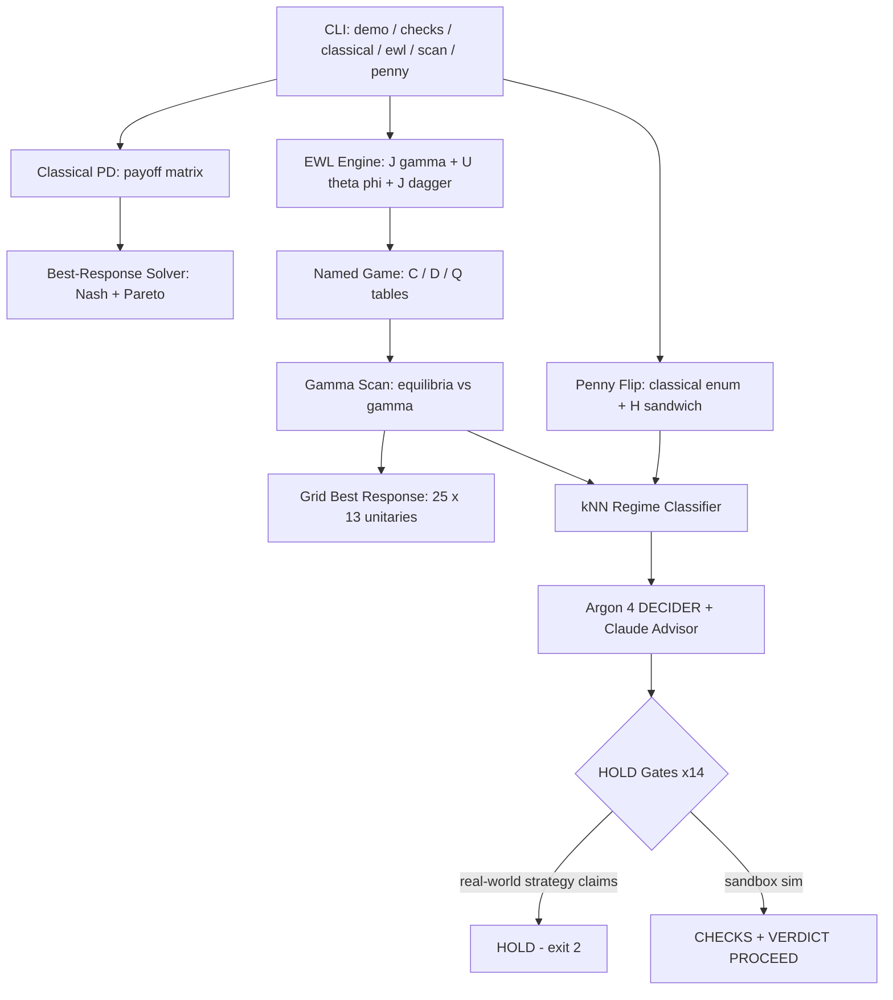
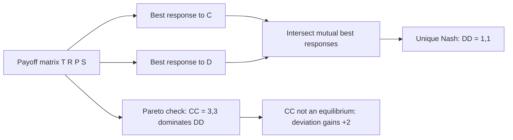
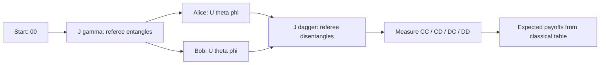
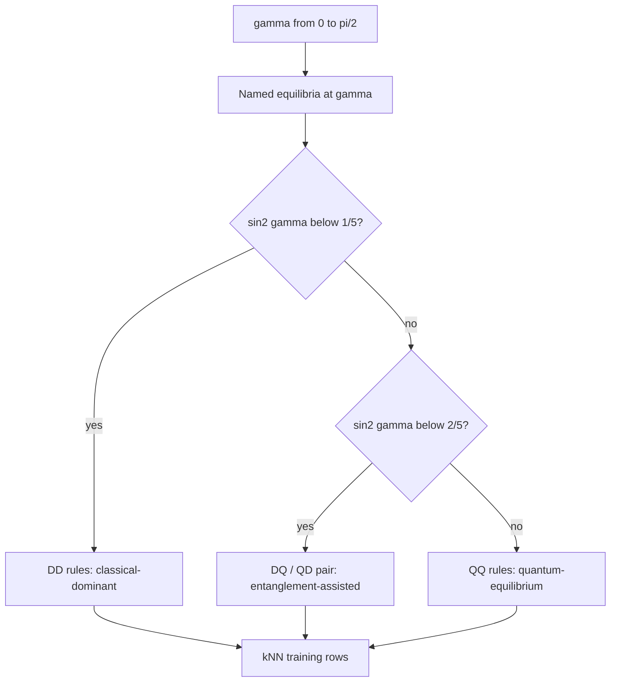
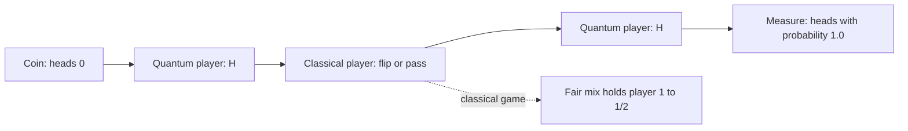
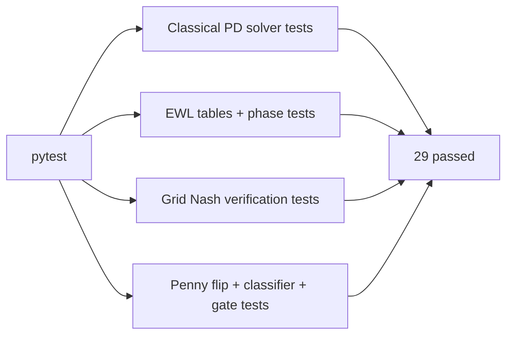
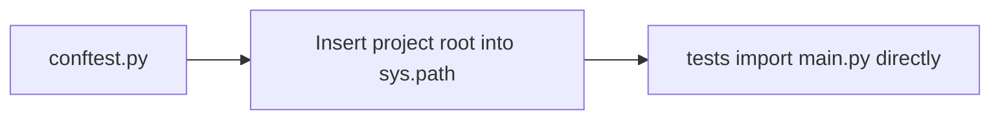
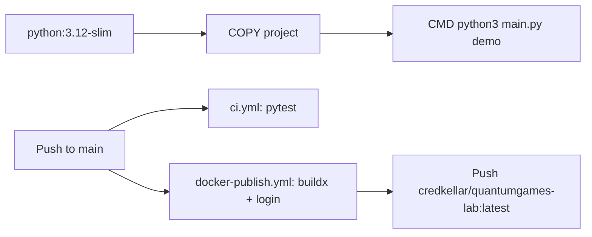

# QuantumGames-Lab 🎲⚛️

**Quantum Game Theory Lab** — by Darion Kellar

QuantumGames-Lab is an **educational quantum game theory lab** in ONE pure-Python file. It takes the two most famous games in the quantum-games literature and computes them honestly, from a two-qubit statevector written from scratch:

- **The Prisoner's Dilemma** (T=5, R=3, P=1, S=0), solved classically by a from-scratch best-response solver — unique Nash equilibrium **(D,D) = (1,1)**, while the Pareto optimum (C,C) = (3,3) sits there unstable — then quantized in the **Eisert–Wilkens–Lewenstein (EWL)** scheme: a referee entangles the players' qubits with J(γ), each player applies a unitary strategy U(θ, φ), the referee disentangles and measures. 🎲
- **Meyer's penny flip**: one coin, three moves. Classically the flipper's 50/50 mix holds the first player to exactly **1/2**; the quantum player's Hadamard sandwich wins with probability **1.0**, computed from the statevector. 🪙

The headline phenomenon is a **phase diagram**: as γ grows, the (Q,Q) payoff never moves — it is (3,3) at every γ, and (D,D) is (1,1) at every γ — but the *stability* moves. (D,D) loses its equilibrium status at γ = arcsin(1/√5) ≈ 0.4636, an asymmetric DQ/QD pair rules the transition band, and past γ = arcsin(√(2/5)) ≈ 0.6847 the unique equilibrium is **(Q,Q) at the Pareto payoff** — verified not just among the named strategies but against a 25×13 grid of *all* unitary deviations. Both transition points are located by the lab's own scan and asserted against the analytic values. 📈

Honest scope, stated up front — the fairness caveat: **the quantum players do not win at the same game.** The referee hands them an entangled state and a strictly larger strategy space. The dilemma dissolves because the rules changed, and this lab says so in its first demo section, in the docstring, and in HOLD gate #14. No quantum hardware is touched, no opponent is real, and every negotiation / market / gambling / real-world strategy claim sits behind a permanent HOLD gate (14 total). 🔒

[](https://github.com/kimanicollier44-cmyk/QuantumGames-Lab/actions/workflows/ci.yml)
[](https://github.com/kimanicollier44-cmyk/QuantumGames-Lab/actions/workflows/docker-publish.yml)

> ℹ️ These are the **live** workflow badges for this repo. They activate as soon as the `ci.yml` and `docker-publish.yml` files from the paste pack are pasted into `.github/workflows/` — until then they have nothing to report yet.

## 🧰 Tech Stack Badges & Full Architecture Tech Stack

### 💻 Core Programming Languages & Core Systems


- 🐍 Python 3.12, pure standard library (`cmath`, `math`, `hashlib`, `json`, `sys`) — zero dependencies, zero network, deterministic (double-run byte-identical)
- 🎲 Game core: a best-response Nash solver over the classical payoff matrix, and an EWL engine — J(γ) entangler, U(θ, φ) strategies, J† disentangling, computational-basis payoffs — every amplitude computed by a from-scratch two-qubit statevector, every claimed property asserted in CHECKS
- 📈 Phase scan: equilibrium structure vs γ over the named set {C, D, Q}, a 25×13 unitary grid for best responses, and a fine γ scan that locates both phase transitions
- 🧠 TinyML kNN regime classifier (from scratch, stdlib): classical-dominant / entanglement-assisted / quantum-equilibrium from (γ, equilibrium payoff, dilemma strength), with every training row computed by the lab's own equilibrium machinery
- 🪑 Council seats: Gemini Argon 4 DECIDER (names-only, tighten-only) + Muse advisor (never overrides HOLD) + Google Flow plan-only (rendered = False, live = 0)

### ⛓️ Web3 & Infrastructure

- 🚫 **Not applicable — honestly.** No blockchain, no Web3, no tokens: the "infrastructure" in this lab is a referee, two qubits, and a payoff matrix inside one offline file. No fake badges here.

### ⚙️ Platform Support & Hardware Architecture


- 🖥️ Pure Python — runs anywhere Python 3.12+ runs (Linux, macOS, Windows), plus the `python:3.12-slim` Docker image
- 🔒 No quantum hardware is touched, ever: the statevector is exact laptop arithmetic, and claiming otherwise is a permanent HOLD gate (see the gate table below)

### ⚡ Low-Level Infrastructure & Performance

- 🚫 **No low-level code — honestly.** No C, no C++, no GPU, no compiled extensions: this is one interpreted Python file on purpose, so every amplitude can be read, checked, and diffed. Performance here means honest algorithms — exhaustive best-response enumeration, a 325-point unitary grid per best-response query, and a 400-step γ scan for the transitions — all deterministic and byte-identical between runs.

### 🛠️ DevOps & Build Tools


- 🐳 Docker (`python:3.12-slim`), GitHub Actions CI + Docker Publish (delivered in the paste pack)
- 🎯 Target image: `credkellar/quantumgames-lab:latest`
- 🧪 Tests: `pytest` (29 tests) + the built-in CHECKS suite (51 checks) in `main.py`

### ☁️ Cloud Providers

- 🚫 **None — honestly.** No cloud provider is used or needed: the lab runs fully offline on your own machine or in a local Docker container. Docker Hub appears only as the registry the publish workflow pushes the image to.

## What this does?

1. ⚖️ **The fairness caveat, first** — the demo opens by stating the catch in plain words: the quantum players beat the classical players because the referee changed the game (entanglement + every unitary as a legal move). The caveat is also HOLD gate #14, so no report from this lab can quietly drop it.
2. 🎲 **Classical Prisoner's Dilemma, solved not quoted** — a best-response solver enumerates both players' replies to each action: defect is the best response to *everything*, the unique Nash equilibrium is **(D,D) = (1,1)**, and the solver confirms (C,C) = (3,3) Pareto-dominates it while not being an equilibrium (deviating against a cooperator gains +2). The dilemma is a theorem of the matrix, shown by enumeration.
3. 🌀 **The EWL referee** — J(γ) = cos(γ/2)·I⊗I + i·sin(γ/2)·σ_y⊗σ_y entangles the two qubits (convention stated openly in the code); players apply U(θ, φ); the referee applies J† and measures. Classical moves are embedded as C = U(0,0), D = U(π,0), and the quantum move is Q = U(0, π/2).
4. 0️⃣ **γ = 0 recovers the classical game, exactly** — with no entanglement the full 3×3 named table collapses onto the classical payoffs, Q degenerates into a phased copy of C, the unique equilibrium is still (D,D), and a grid search over all unitary deviations finds nothing better than 1.0 against D. No entanglement, no miracle — asserted in CHECKS.
5. 📈 **The γ scan — payoffs frozen, stability moves** — across the whole scan, (Q,Q) pays (3,3) and (D,D) pays (1,1) at *every* γ. What changes is which profiles are equilibria: DD alone at low γ, the asymmetric pair DQ/QD in the middle band, QQ alone at high γ. The lab prints the whole table.
6. 🎯 **Both phase transitions, located and cross-checked** — a 400-step scan watches the equilibrium flags flip: (D,D) falls at γ ≈ 0.4673 and (Q,Q) rises at γ ≈ 0.6872, asserted within 0.01 of the analytic arcsin(1/√5) ≈ 0.4636 and arcsin(√(2/5)) ≈ 0.6847.
7. 🏆 **Full entanglement: the dilemma dissolves** — at γ = π/2 the named table reads CQ = QC = (1,1), DQ = (0,5), QD = (5,0), QQ = (3,3). (Q,Q) is the unique named equilibrium, and the 25×13 grid search over *all* unitary deviations confirms neither player can beat 3.0 against Q — a grid-verified Nash equilibrium at the Pareto payoff. (D,D) still pays (1,1) but is destroyed: facing D, the best reply is now Q, worth 5.0.
8. 🪙 **Meyer's penny flip** — classically, every first-player strategy wins exactly 1/2 against the flipper's fair mix (and the lab also shows the mix is doing the work: against a *pure* opponent, a classical strategy wins 1.0). The quantum line H → (flip or not) → H returns the coin to heads with probability exactly **1.0** against both opponent moves, because X|+⟩ = |+⟩ — the flip becomes a phase the second Hadamard erases.
9. 🏷️ **Regime classifier** — a from-scratch kNN labels game points classical-dominant / entanglement-assisted / quantum-equilibrium from (γ fraction, selected equilibrium payoff, dilemma strength δ = (T−R)/(T−P)). Every one of its 39 training rows is *computed* by the lab's own equilibrium machinery over a (γ, T) grid — the classifier interpolates the lab's measured phase diagram, nothing is hand-labelled.
10. 🔒 **Seats, gates, checks** — Gemini Argon 4 DECIDER (sha256 trace), Muse advisor, Google Flow plan-only, 14 HOLD gates, and a built-in CHECKS suite (51 checks) that re-derives every headline claim above before the demo will print PROCEED.

## 🗺️ How it works — diagram per script

### `main.py` — the whole lab



### Classical solver — best responses in, equilibrium out



### EWL round — one quantized game



### Gamma scan — where the equilibrium moves



### Penny flip — the Hadamard sandwich



### `tests/test_main.py` — verification



### `conftest.py` — test path setup



### `Dockerfile` + CI flow — container & publish



## Why is this cool?

1. 🎲 The dilemma is **solved by enumeration, not quoted**: the best-response solver *finds* (D,D) — you watch defect dominate against both opponent actions, and you watch (C,C) fail the equilibrium test by exactly +2.
2. 📈 The phase diagram is the real discovery: **the payoffs never move, the stability does.** (Q,Q) pays (3,3) at γ = 0 too — it just isn't stable until entanglement crosses sin²γ = 2/5. That one table teaches more game theory than the headline "quantum wins".
3. 🎯 The (Q,Q) equilibrium is **grid-verified, not named-set-verified**: a 25×13 search over the whole two-parameter unitary family finds no deviation worth more than 3.0 against Q, for either player. The equilibrium survives contact with the full strategy space the lab allows.
4. 🧭 Both phase transitions are **measured and cross-checked**: the scan's flip points land within 0.01 of arcsin(1/√5) and arcsin(√(2/5)) — numerical experiment meeting analytic theory, each grading the other.
5. 0️⃣ The γ = 0 control experiment is done properly: no entanglement, and the quantum machinery collapses *exactly* onto the classical game — Q becomes a phased C and the grid can't beat (D,D). The lab proves its own effect is really entanglement.
6. 🪙 The penny flip is a perfect miniature: one Hadamard, one irrelevant flip, one Hadamard — probability **1.0**, with the classical 1/2 shown beside it and the reason (X|+⟩ = |+⟩) stated in one line.
7. ⚖️ The fairness caveat is load-bearing, not decorative: it's the docstring's first lesson, demo section [1], and HOLD gate #14 — the lab refuses to let its own headline be quoted without the rules-change attached.
8. 🏷️ The classifier's training data is **computed, not labelled by hand**: 39 rows of (γ, T) phase space, each labelled by running the lab's own equilibrium finder. The kNN interpolates a measured phase diagram.
9. 🔍 Every amplitude is inspectable: the statevector code is ~40 lines of visible list arithmetic — no library hides the J, the strategies, or the measurement.
10. 🎯 Deterministic end to end: run it twice, get byte-identical output — a quantum game you can diff.

## What problems this solves?

1. ❌ **Problem:** "Quantum games beat classical games" is usually stated as magic. ✅ **Solution:** The lab states the rules change up front (entanglement + enlarged strategy space), gates the overclaim (#7, #14), and shows the γ = 0 control where the magic vanishes.
2. ❌ **Problem:** Textbook Nash equilibria are asserted, not derived. ✅ **Solution:** A best-response solver enumerates the replies and intersects them; the equilibrium is an output, and the test suite re-derives it.
3. ❌ **Problem:** The EWL result is usually shown only at γ = π/2, hiding the interesting part. ✅ **Solution:** The full γ scan exposes two phase transitions and the asymmetric DQ/QD band between them — the equilibrium *moves*, measurably.
4. ❌ **Problem:** "Q is a Nash equilibrium" is often checked only against C and D. ✅ **Solution:** The lab grid-searches all 325 (θ, φ) deviations against Q for both players and reports the best deviation payoff (3.0 — no gain).
5. ❌ **Problem:** Phase-transition values get quoted from papers without verification. ✅ **Solution:** A 400-step scan locates the flips numerically and asserts them against arcsin(1/√5) and arcsin(√(2/5)) to within 0.01.
6. ❌ **Problem:** Penny-flip explanations skip why the classical player can't do the same. ✅ **Solution:** The classical enumeration shows every strategy at exactly 1/2 against the fair mix — and shows the mix is essential, since a pure opponent *can* be beaten classically.
7. ❌ **Problem:** Quantum-game demos quietly use numpy/simulators that hide the math. ✅ **Solution:** One stdlib file: kron, dagger, and matvec as readable list code; unitarity of J and U is asserted on grids in CHECKS.
8. ❌ **Problem:** Payoff conventions differ between papers and silently change results. ✅ **Solution:** The J convention, the U(θ, φ) parametrization, and the basis order are stated in the docstring, and every claimed property is verified numerically rather than imported from a citation.
9. ❌ **Problem:** ML classifiers in teaching labs train on hand-made labels. ✅ **Solution:** The kNN's 39 training rows are generated by the lab's own equilibrium machinery over a (γ, T) grid — labels are computed phase structure.
10. ❌ **Problem:** Game-theory toys get repackaged as negotiation/market/gambling strategies. ✅ **Solution:** 14 named HOLD gates return exit code 2 for every real-world strategy, gambling, market, election, or deployment claim, forever.

## How to install this?

1. 📋 Clone or download this project folder.
2. 🐍 Make sure Python 3.12+ is installed: `python3 --version`
3. ▶️ Run the full demo + checks (no arguments needed):

```bash
python3 main.py
```

4. 🧪 Run the test suite:

```bash
pip install pytest
python3 -m pytest -q
```

5. 🎛️ Try the other commands:

```bash
python3 main.py checks    # 51 built-in checks
python3 main.py classical # classical PD: best responses, Nash, Pareto
python3 main.py ewl       # EWL tables at gamma 0 and pi/2 + grid best responses
python3 main.py scan      # gamma scan + measured vs analytic transitions
python3 main.py penny     # penny flip: classical 1/2 vs quantum 1.0
python3 main.py classify  # kNN regime classifier report
python3 main.py brains    # Argon 4 + Muse + Flow seats
python3 main.py holds     # list all 14 HOLD gates
python3 main.py hold-demo # exits 2 - gated actions stay HOLD
```

6. 🐳 Or run it in Docker:

```bash
docker build -t credkellar/quantumgames-lab:latest .
docker run --rm credkellar/quantumgames-lab:latest
```

## Requirements

- 🐍 Python 3.12 or newer
- 📦 Dependencies: **none** (standard library only)
- 🌐 Network: **none** — fully offline
- 🧪 For tests only: `pytest`
- 🐳 Optional: Docker

## FULL project structure tree

```text
quantumgames-lab/
├── main.py                  # the whole lab: classical PD solver, EWL engine, gamma scan, grid best responses, penny flip, classifier, seats, HOLD gates
├── conftest.py              # puts the project root on sys.path for tests
├── tests/
│   └── test_main.py         # 29 pytest tests: classical solver, EWL tables, phases, grid Nash, penny flip, classifier, gates
├── assets/
│   └── cover.png            # README cover image (2736 x 912)
├── Dockerfile               # python:3.12-slim, runs the demo
├── .gitignore               # __pycache__/, .pytest_cache/, *.pyc
└── README.md                # this file
```

> 📦 Delivered separately as paste packs (not in this tree): `.github/workflows/ci.yml` + `docker-publish.yml`, and the Docker Hub pack (100-char description, 350-char About, overview, categories).

## 🔒 HOLD gates — all 14, permanent

| # | Gate | What stays held |
|---|------|-----------------|
| 1 | `real_money_gambling` | No gambling, betting, or wagering use; the penny flip is a teaching game, not a betting system |
| 2 | `financial_market_strategy_claim` | No claim that quantum game strategies beat real markets, trading, or investing |
| 3 | `negotiation_or_contract_use` | No use in real negotiations, contracts, labour disputes, or plea bargaining |
| 4 | `auction_or_bidding_manipulation` | No real auction, bidding, or procurement strategy use |
| 5 | `mechanism_design_deployment` | No deploying game mechanisms for real platforms, users, or voters |
| 6 | `quantum_hardware_result_claim` | No claim any result ran on quantum hardware; it is laptop statevector arithmetic |
| 7 | `quantum_advantage_overclaim` | The quantum edge is an enlarged strategy space + referee entanglement; never magic, never a free advantage at the same game |
| 8 | `adversarial_exploit_design` | No designing exploits against real counterparties, protocols, or platforms |
| 9 | `election_or_voting_manipulation` | No voting, election, or governance game manipulation |
| 10 | `military_or_conflict_strategy` | No military, escalation, or conflict strategy use |
| 11 | `pricing_collusion_strategy` | No collusion, price-fixing, or antitrust-evading strategy use |
| 12 | `ai_agent_deployment_claim` | No deploying game-playing agents against real users or services |
| 13 | `behavioural_manipulation` | No manipulating real people's decisions with game-theoretic pressure |
| 14 | `referee_fairness_overclaim` | Never present the entangled-referee game as the same game as the classical dilemma — the referee changes the rules |

🧑‍⚖️ **Council seats:** Gemini Argon 4 Extended Thinking — DECIDER (names-only, tighten-only, MAP → MODEL → STRESS → DECIDE, sha256 trace, `can_override_hold = False`) · Muse — advisor (`can_override_hold = False`) · Google Flow — plan-only (`rendered = False`, `live = 0`).

✅ **Verification:** pytest **29 passed** (project + clean copy) · built-in CHECKS **51/51** · double-run output **byte-identical** · `hold-demo` exits **2** · `main.py` **865 lines**, pure stdlib, zero network.

## 🧒 5th-grade English section

Imagine two friends, Alice and Bob, who each have to pick a card: **Be Nice** or **Be Sneaky**. 🎲

- If both pick Be Nice, both get 3 candies. 🍬🍬🍬
- If one picks Be Sneaky and the other picks Be Nice, the sneaky one gets 5 candies and the nice one gets 0!
- If both pick Be Sneaky, both get only 1 candy.

Here is the tricky part: being sneaky is *always* the safer pick for yourself, no matter what your friend does. So both friends pick Be Sneaky, and both end up with just 1 candy — even though both being nice would have given them 3 each! Grown-ups call this the **Prisoner's Dilemma**, and this lab's computer checks every choice to prove it. 😕

Now a referee changes the game. The referee ties the two coins together with invisible string (scientists call this **entanglement**), and now the players can do fancy spins instead of just picking a card. When the string is pulled all the way tight, both friends spinning the special "Q" way becomes the smart, safe pick — and both get 3 candies! 🎉 But the lab is honest: **the referee changed the game.** The string and the fancy spins are new rules, not a magic trick for winning the old game.

The lab also has a coin game. A coin starts heads-up. One player can flip it or leave it, and classically the first player can only win half the time. But the quantum player waves the coin into a fuzzy in-between state, and — flip or no flip — it always lands heads at the end. 🪙✨

This project is a **pretend lab on a computer**. Nobody wins real candy, real money, or real arguments with it. It just helps you learn how games, choices, and a little bit of quantum string work. 💻

---

MIT © 2026 Darion Kellar · QuantumGames-Lab — educational simulation only 🎲
